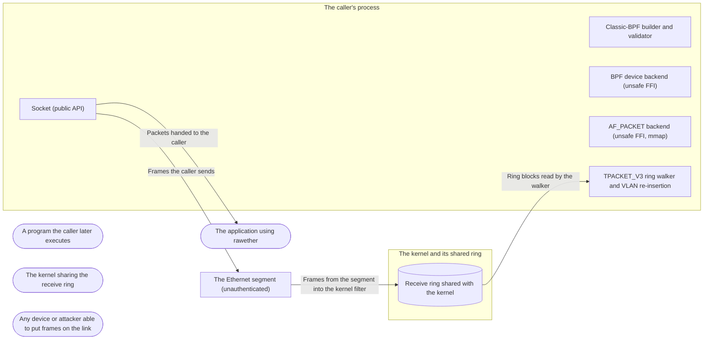

# Threat Model: rawether 0.1.0 — raw layer-2 Ethernet I/O

**Feature**: `001-raw-l2-crate` · **Generated**: 2026-11-09T10:49:21Z · **Profiles**: stride · **Canonical**: `threat-model.yaml`

> Rendered by ThreatSpec. Edit `threat-model.yaml`, not this file.

## Summary

| Threats | Critical | High | Medium | Low | Needs clarification | Not applicable | Mitigations | Requirements | Decisions |
|---|---|---|---|---|---|---|---|---|---|
| 9 | 0 | 2 | 5 | 2 | 0 | 5 | 9 | 9 | 1 |

## Actors

| ID | Name | Trust | Description |
|---|---|---|---|
| `actor.caller` | The application using rawether | trusted |  |
| `actor.child-process` | A program the caller later executes | semi-trusted |  |
| `actor.kernel` | The kernel sharing the receive ring | privileged |  |
| `actor.segment-peer` | Any device or attacker able to put frames on the link | untrusted |  |

## Trust Zones

| ID | Name | Trust rating | Description |
|---|---|---|---|
| `tz.kernel` | The kernel and its shared ring | 9 |  |
| `tz.link` | The Ethernet segment (unauthenticated) | 1 |  |
| `tz.process` | The caller's process | 8 |  |

## Assets

| ID | Name | Type | Classification | C / I / A | Source |
|---|---|---|---|---|---|
| `asset.link-traffic` | Other hosts' traffic on the segment | business-data | confidential | 70 / 20 / 20 | spec.md#FR-002 |
| `asset.process-memory` | Memory safety of the caller's process | business-data | internal | 80 / 95 / 80 | spec.md#FR-009 |
| `asset.raw-capability` | The raw-socket capability (CAP_NET_RAW, or /dev/bpf access) and the open socket | credential | restricted | 60 / 85 / 30 | spec.md#User-Story-1 |
| `asset.received-frames` | Frames delivered to the caller, with their lengths and timestamps | business-data | internal | 50 / 80 / 80 | spec.md#FR-004 |

## Components

| ID | Name | Type | Trust zone | Source |
|---|---|---|---|---|
| `component.bpf` | Classic-BPF builder and validator | library | `tz.process` | spec.md#FR-008 |
| `component.bsd-backend` | BPF device backend (unsafe FFI) | library | `tz.process` | plan.md#Project-Structure |
| `component.linux-backend` | AF_PACKET backend (unsafe FFI, mmap) | library | `tz.process` | plan.md#Project-Structure |
| `component.ring-walker` | TPACKET_V3 ring walker and VLAN re-insertion | library | `tz.process` | plan.md#Project-Structure |
| `component.rx-ring` | Receive ring shared with the kernel | datastore | `tz.kernel` | research.md#Ring-walk-TPACKET_V3 |
| `component.socket` | Socket (public API) | library | `tz.process` | plan.md#Project-Structure |

## Data Flows

| ID | Name | From | To | Assets | Crosses |
|---|---|---|---|---|---|
| `flow.caller-to-link` | Frames the caller sends | `component.socket` | `tz.link` | `asset.link-traffic` | `tz.link` |
| `flow.link-to-kernel` | Frames from the segment into the kernel filter | `tz.link` | `component.rx-ring` | `asset.received-frames` | `tz.link` |
| `flow.ring-to-walker` | Ring blocks read by the walker | `component.rx-ring` | `component.ring-walker` | `asset.received-frames`, `asset.process-memory` | `tz.kernel` |
| `flow.walker-to-caller` | Packets handed to the caller | `component.socket` | `actor.caller` | `asset.received-frames` |  |

## Threats

| ID | Threat | Category | Technique | Severity | Status | Mitigations | Mappings | Source |
|---|---|---|---|---|---|---|---|---|
| `threat.capability-retained` | The caller keeps CAP_NET_RAW (or root) while parsing untrusted frames, so any parser defect runs with raw-network privilege | Elevation of Privilege | broken-access-control | **high** | mitigated | `mitigation.drop-capabilities` |  | spec.md#Acceptance-Scenarios |
| `threat.fd-inherited-by-child` | The raw socket or BPF device descriptor is inherited by a program the caller executes, which gains raw network access | Elevation of Privilege | broken-access-control | **high** | mitigated | `mitigation.close-on-exec` |  | plan.md#Constitution-Check |
| `threat.hostile-frame-shape` | A peer sends truncated, oversized or crafted VLAN frames that make the re-insertion or length reporting panic or lie | Tampering | injection | **medium** | mitigated | `mitigation.bounded-frame-handling` |  | spec.md#Edge-Cases |
| `threat.packet-outlives-block` | A Packet still borrowed by the caller is handed back to the kernel and rewritten underneath it | Tampering | data-tampering-in-transit | **medium** | mitigated | `mitigation.borrowed-packets` |  | spec.md#Clarifications |
| `threat.ring-exhaustion` | A peer floods the segment so the ring fills and frames are dropped without the caller being able to tell | Denial of Service | resource-exhaustion | **medium** | mitigated | `mitigation.bounded-buffers-and-counted-drops` |  | spec.md#Edge-Cases |
| `threat.ring-offsets-out-of-bounds` | Offsets in a ring block (kernel bug, version mismatch, or a block read while the kernel owns it) make the backend form a slice outside the mapping | Tampering | injection | **medium** | mitigated | `mitigation.checked-ring-walk` |  | research.md#Ring-walk-TPACKET_V3 |
| `threat.unfiltered-window` | Frames arrive between bind and filter attach, or a user BPF program the kernel would reject is accepted, so the caller sees traffic its filter excludes | Tampering | injection | **medium** | mitigated | `mitigation.filter-before-bind` |  | research.md#Linux-open-sequence |
| `threat.launch-time-abuse` | Launch times far in the future, or sends without a txtime qdisc, hold or silently drop frames on the egress queue | Denial of Service | resource-exhaustion | **low** | accepted (until 2026-12-31) | `mitigation.txtime-opt-in-and-reported` |  | research.md#Transmit |
| `threat.promiscuous-disclosure` | Promiscuous or all-multicast mode left on by default exposes other hosts' traffic to the caller | Information Disclosure | sensitive-data-exposure | **low** | mitigated | `mitigation.explicit-promiscuity` |  | spec.md#FR-002 |

### Techniques evaluated without findings

| Technique | Disposition | Reason |
|---|---|---|
| credential-theft | not-applicable | no authentication surface: rawether handles no credentials; its only privilege is the raw-socket capability, modelled under broken-access-control |
| identity-spoofing | no-threat-detected | checked the receive path: layer 2 has no sender identity and the crate claims none; source MACs are delivered as received, and authenticating them is the caller's protocol's job |
| data-tampering-at-rest | not-applicable | no persistent-store surface: nothing is written to disk |
| missing-audit-trail | not-applicable | no audit-relevant surface: a socket library keeps no audit log |
| cross-tenant-leak | not-applicable | no shared-tenant surface: one socket belongs to one process |
| privilege-escalation-via-config | not-applicable | no persistent-store surface: configuration is a value the caller builds in code |

## Mitigations

| ID | Mitigation | Kind | Threats | Requirements | Touchpoints | Status |
|---|---|---|---|---|---|---|
| `mitigation.borrowed-packets` | Packet borrows the Socket mutably; a block is released only at the next receive | preventive | `threat.packet-outlives-block` | SR-002 | `src/lib.rs`, `src/sys/linux.rs` | verified |
| `mitigation.bounded-buffers-and-counted-drops` | Ring and buffers have a fixed size; kernel drop counters are accumulated and readable | detective | `threat.ring-exhaustion` | SR-008 | `src/sys/linux.rs`, `src/sys/bsd.rs` | verified |
| `mitigation.bounded-frame-handling` | Re-insertion and length reporting are bounds-checked and total: captured and wire lengths reported, truncation flagged, never a panic | preventive | `threat.hostile-frame-shape` | SR-003 | `src/vlan.rs`, `src/ring.rs`, `src/packet.rs` | verified |
| `mitigation.checked-ring-walk` | Blocks are read only after TP_STATUS_USER is observed with acquire ordering; every kernel offset is checked against the block before a slice is formed | preventive | `threat.ring-offsets-out-of-bounds` | SR-001 | `src/ring.rs`, `src/sys/linux.rs` | verified |
| `mitigation.close-on-exec` | Every descriptor is opened close-on-exec | preventive | `threat.fd-inherited-by-child` | SR-006 | `src/sys/linux.rs`, `src/sys/bsd.rs` | verified |
| `mitigation.drop-capabilities` | drop_capabilities() clears the process's capability sets once sockets are open; open sockets keep working | preventive | `threat.capability-retained` | SR-005 | `src/lib.rs`, `src/sys/linux.rs`, `README.md` | verified |
| `mitigation.explicit-promiscuity` | Promiscuous and all-multicast are off unless the caller asks | preventive | `threat.promiscuous-disclosure` | SR-007 | `src/config.rs` | verified |
| `mitigation.filter-before-bind` | The socket is created with protocol 0, the filter attached, then bound; user programs validated as the kernel validates them | preventive | `threat.unfiltered-window` | SR-004 | `src/sys/linux.rs`, `src/sys/bsd.rs`, `src/bpf.rs` | verified |
| `mitigation.txtime-opt-in-and-reported` | send_at is refused unless launch time was configured; dropped launch-time frames are drained from the error queue and counted | detective | `threat.launch-time-abuse` | SR-009 | `src/sys/linux.rs` | required |

## Security Requirements

### SR-001 (P1) — verified

The ring walker MUST NOT form a slice outside the block, and MUST NOT read a block whose status lacks TP_STATUS_USER.

- **Given** a synthetic block whose frame claims data beyond the block, **when** it is walked, **then** the walk ends and the rest of the block is skipped
- **Given** a block owned by the kernel, **when** the walker starts, **then** it reads nothing
- Mitigations: `mitigation.checked-ring-walk`
- Tasks: T006 ✓, T012 ✓
- Verification `verification.sr-001.2026-11-09`: test → pass (verified) — `src/ring.rs::tests::offsets_that_point_outside_the_block_end_the_walk`
- Verification `verification.sr-001.2026-11-09-2`: test → pass (verified) — `src/ring.rs::tests::offsets_that_point_outside_the_block_end_the_walk`
- Verification `verification.sr-001.2026-11-09-3`: test → pass (verified) — `src/ring.rs::tests::offsets_that_point_outside_the_block_end_the_walk`

### SR-002 (P1) — verified

A received Packet MUST borrow the Socket so that no further receive, and no block release, can happen while it is alive.

- **Given** a Packet from recv, **when** the caller calls recv again while holding it, **then** the program does not compile (compile-fail doc test)
- Mitigations: `mitigation.borrowed-packets`
- Tasks: T010 ✓, T012 ✓
- Verification `verification.sr-002.2026-11-09`: test → pass (verified) — `src/lib.rs::Socket::recv (compile_fail doctest)`
- Verification `verification.sr-002.2026-11-09-2`: test → pass (verified) — `src/lib.rs::Socket::recv (compile_fail doctest)`
- Verification `verification.sr-002.2026-11-09-3`: test → pass (verified) — `src/lib.rs::Socket::recv (compile_fail doctest)`

### SR-003 (P1) — verified

VLAN re-insertion and length reporting MUST be total over every input: no panic, captured length never above wire length, truncation flagged.

- **Given** any buffer, start, length and tag, **when** re-insertion runs, **then** it either succeeds inside the buffer or leaves it untouched, never panicking (property test)
- Mitigations: `mitigation.bounded-frame-handling`
- Tasks: T007 ✓
- Verification `verification.sr-003.2026-11-09`: test → pass (verified) — `src/vlan.rs::tests::reinsertion_is_total_over_small_inputs`
- Verification `verification.sr-003.2026-11-09-2`: test → pass (verified) — `src/vlan.rs::tests::reinsertion_is_total_over_small_inputs; tests/veth.rs::a_short_snap_length_marks_the_frame_truncated_with_its_wire_length`
- Verification `verification.sr-003.2026-11-09-3`: test → pass (verified) — `src/vlan.rs::tests::reinsertion_is_total_over_small_inputs; tests/veth.rs::a_short_snap_length_marks_the_frame_truncated_with_its_wire_length`

### SR-004 (P2) — verified

The Linux backend MUST attach the filter before binding, and Program::new MUST reject what the kernel rejects (empty, too long, jumps past the end, bad scratch slot, no final return).

- **Given** a filtered socket on a busy veth, **when** the first frames are received, **then** none of another EtherType appears
- **Given** an invalid program, **when** Program::new runs, **then** it returns InvalidInput
- Mitigations: `mitigation.filter-before-bind`
- Tasks: T005 ✓, T008 ✓, T011 ✓
- Verification `verification.sr-004.2026-11-09`: test → pass (verified) — `tests/veth.rs::only_the_chosen_ethertypes_arrive_tagged_or_not_each_with_a_timestamp`
- Verification `verification.sr-004.2026-11-09-2`: test → pass (verified) — `tests/veth.rs::only_the_chosen_ethertypes_arrive_tagged_or_not_each_with_a_timestamp`
- Verification `verification.sr-004.2026-11-09-3`: test → pass (verified) — `tests/veth.rs::only_the_chosen_ethertypes_arrive_tagged_or_not_each_with_a_timestamp`

### SR-005 (P1) — verified

rawether MUST offer drop_capabilities() that leaves the process with no effective or permitted capabilities while open sockets keep receiving and sending.

- **Given** a socket opened with CAP_NET_RAW, **when** drop_capabilities() returns, **then** CapEff and CapPrm are zero and the socket still sends and receives
- Mitigations: `mitigation.drop-capabilities`
- Tasks: T010 ✓, T011 ✓
- Verification `verification.sr-005.2026-11-09`: test → pass (verified) — `tests/veth.rs::dropping_capabilities_keeps_open_sockets_and_names_the_capability_when_opening`
- Verification `verification.sr-005.2026-11-09-2`: test → pass (verified) — `tests/veth.rs::dropping_capabilities_keeps_open_sockets_and_names_the_capability_when_opening`
- Verification `verification.sr-005.2026-11-09-3`: test → pass (verified) — `tests/veth.rs::dropping_capabilities_keeps_open_sockets_and_names_the_capability_when_opening`

### SR-006 (P1) — verified

Every descriptor rawether opens MUST be close-on-exec.

- **Given** an open socket, **when** its descriptor flags are read, **then** FD_CLOEXEC is set
- Mitigations: `mitigation.close-on-exec`
- Tasks: T008 ✓, T009 ✓, T011 ✓
- Verification `verification.sr-006.2026-11-09`: test → pass (verified) — `tests/veth.rs::every_descriptor_is_close_on_exec`
- Verification `verification.sr-006.2026-11-09-2`: test → pass (verified) — `tests/veth.rs::every_descriptor_is_close_on_exec`
- Verification `verification.sr-006.2026-11-09-3`: test → pass (verified) — `tests/veth.rs::every_descriptor_is_close_on_exec`

### SR-007 (P2) — verified

A default Config MUST NOT enable promiscuous or all-multicast mode.

- **Given** Config::new(iface), **when** it is inspected, **then** promiscuous and all-multicast are false
- Mitigations: `mitigation.explicit-promiscuity`
- Tasks: T004 ✓
- Verification `verification.sr-007.2026-11-09`: test → pass (verified) — `src/lib.rs::tests::the_default_configuration_is_neither_promiscuous_nor_all_multicast`
- Verification `verification.sr-007.2026-11-09-2`: test → pass (verified) — `src/lib.rs::tests::the_default_configuration_is_neither_promiscuous_nor_all_multicast`
- Verification `verification.sr-007.2026-11-09-3`: test → pass (verified) — `src/lib.rs::tests::the_default_configuration_is_neither_promiscuous_nor_all_multicast`

### SR-008 (P2) — verified

stats() MUST report kernel drops so that received plus dropped equals what passed the filter.

- **Given** 100 000 frames sent over veth, **when** stats() is read after receiving, **then** received plus dropped equals the frames sent
- Mitigations: `mitigation.bounded-buffers-and-counted-drops`
- Tasks: T013 ✓, T014 ✓
- Verification `verification.sr-008.2026-11-09`: test → pass (verified) — `tests/veth.rs::a_hundred_thousand_frames_are_received_or_counted_as_dropped`
- Verification `verification.sr-008.2026-11-09-2`: test → pass (verified) — `tests/veth.rs::a_hundred_thousand_frames_are_received_or_counted_as_dropped`
- Verification `verification.sr-008.2026-11-09-3`: test → pass (verified) — `tests/veth.rs::a_hundred_thousand_frames_are_received_or_counted_as_dropped`

### SR-009 (P2) — verified

send_at MUST fail with InvalidInput unless Config::tx_time was set, and tx_errors() MUST count frames the kernel reported dropped.

- **Given** a socket without tx_time, **when** send_at is called, **then** it returns InvalidInput
- **Given** a socket with tx_time on an interface without an etf qdisc, **when** a frame is sent with a launch time, **then** tx_errors() counts it or the send fails
- Mitigations: `mitigation.txtime-opt-in-and-reported`
- Tasks: T013 ✓, T014 ✓, T020
- Verification `verification.sr-009.2026-11-09`: review → inconclusive (implemented-unverified) — `src/sys/linux.rs:send_at`
- Verification `verification.sr-009.2026-11-09-2`: review → inconclusive (implemented-unverified) — `src/sys/linux.rs:send_at`
- Verification `verification.sr-009.2026-11-09-3`: review → inconclusive (implemented-unverified) — `src/sys/linux.rs:send_at`
- Verification `verification.sr-009.2026-11-09-4`: test → pass (verified) — `tests/veth.rs::launch_time_needs_configuration_and_a_qdisc_that_honours_it (CI run https://github.com/hupe1980/rawether/actions/runs/42617140283, ubuntu-24.04 with sch_etf, RAWETHER_REQUIRE_ETF=1, commit 9692423)`

## Risk Decisions

| ID | Threat | Status | Owner | Expires | Rationale |
|---|---|---|---|---|---|
| `decision.etf-half-runs-in-ci` | `threat.launch-time-abuse` | accepted | @hupe1980 | 2026-12-31 | SR-009 scenario 1 (send_at refused without tx_time) is verified on a real kernel. Scenario 2 needs the sch_etf qdisc, which the local Docker kernel lacks; the test exists, skips there by name, and runs in the ubuntu-24.04 CI lane on every push. The residual risk is a launch-time frame dropped without being counted, which only affects callers who opt into SO_TXTIME. |
