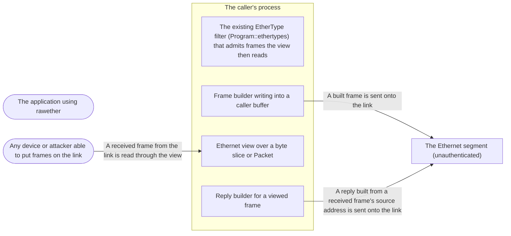

# Threat Model: Ethernet frame views and frame building

**Feature**: `002-ethernet-frames` · **Generated**: 2026-11-09T11:28:40Z · **Profiles**: stride · **Canonical**: `threat-model.yaml`

> Rendered by ThreatSpec. Edit `threat-model.yaml`, not this file.

## Summary

| Threats | Critical | High | Medium | Low | Needs clarification | Not applicable | Mitigations | Requirements | Decisions |
|---|---|---|---|---|---|---|---|---|---|
| 6 | 1 | 1 | 3 | 1 | 0 | 6 | 6 | 6 | 0 |

## Actors

| ID | Name | Trust | Description |
|---|---|---|---|
| `actor.caller` | The application using rawether | trusted |  |
| `actor.segment-peer` | Any device or attacker able to put frames on the link | untrusted |  |

## Trust Zones

| ID | Name | Trust rating | Description |
|---|---|---|---|
| `tz.link` | The Ethernet segment (unauthenticated) | 1 |  |
| `tz.process` | The caller's process | 8 |  |

## Assets

| ID | Name | Type | Classification | C / I / A | Source |
|---|---|---|---|---|---|
| `asset.frame-interpretation` | The caller's reading of a frame: addresses, VLAN, EtherType and payload boundaries | business-data | internal | 20 / 85 / 40 | spec.md#FR-001 |
| `asset.link-traffic` | Other hosts' traffic and capacity on the segment | business-data | internal | 30 / 50 / 70 | spec.md#User-Story-3 |
| `asset.outgoing-frames` | Frames the caller builds and sends, including bytes of earlier frames left in a reused buffer | business-data | internal | 70 / 80 / 30 | spec.md#User-Story-2 |
| `asset.process-availability` | The caller's process staying up while it handles frames from the link | business-data | internal | 0 / 40 / 90 | spec.md#User-Story-1 |

## Components

| ID | Name | Type | Trust zone | Source |
|---|---|---|---|---|
| `component.bpf-ethertype-filter` | The existing EtherType filter (Program::ethertypes) that admits frames the view then reads | library | `tz.process` | spec.md#Edge-Cases |
| `component.frame-builder` | Frame builder writing into a caller buffer | library | `tz.process` | spec.md#FR-005 |
| `component.frame-view` | Ethernet view over a byte slice or Packet | library | `tz.process` | plan.md#Source-Code |
| `component.reply-helper` | Reply builder for a viewed frame | library | `tz.process` | spec.md#FR-008 |

## Data Flows

| ID | Name | From | To | Assets | Crosses |
|---|---|---|---|---|---|
| `flow.builder-to-link` | A built frame is sent onto the link | `component.frame-builder` | `tz.link` | `asset.outgoing-frames` | `tz.process`, `tz.link` |
| `flow.received-frame-to-view` | A received frame from the link is read through the view | `actor.segment-peer` | `component.frame-view` | `asset.frame-interpretation`, `asset.process-availability` | `tz.link`, `tz.process` |
| `flow.reply-to-link` | A reply built from a received frame's source address is sent onto the link | `component.reply-helper` | `tz.link` | `asset.link-traffic`, `asset.outgoing-frames` | `tz.process`, `tz.link` |

## Threats

| ID | Threat | Category | Technique | Severity | Status | Mitigations | Mappings | Source |
|---|---|---|---|---|---|---|---|---|
| `threat.view-panic-on-hostile-frame` | A link peer sends a frame shorter than the header it announces (or with crafted tags) and the view panics, taking down the caller's receive loop | Denial of Service | resource-exhaustion | **critical** | mitigated | `mitigation.total-view` |  | spec.md#User-Story-1 |
| `threat.view-filter-disagreement` | The view and the kernel EtherType filter disagree about tags, so a peer's crafted frame passes the filter for one EtherType while the caller reads another type or the wrong payload boundary | Tampering | injection | **high** | mitigated | `mitigation.shared-tag-rules` |  | spec.md#Edge-Cases |
| `threat.reply-reflection` | A peer sends a frame with a group (multicast or broadcast) source address and the reply helper answers to that group, turning one frame into a segment-wide reply storm | Denial of Service | resource-exhaustion | **medium** | mitigated | `mitigation.no-reply-to-groups` |  | spec.md#User-Story-3 |
| `threat.stale-buffer-disclosure` | Building a short frame into a buffer reused from a longer one leaves earlier frame bytes in the padding, disclosing them on the link | Information Disclosure | sensitive-data-exposure | **medium** | mitigated | `mitigation.replace-and-zero-pad` |  | spec.md#User-Story-2 |
| `threat.tag-field-truncation` | A VLAN id or priority out of range is silently masked when building, so the caller's frame lands in a different VLAN or traffic class than intended | Tampering | data-tampering-in-transit | **medium** | mitigated | `mitigation.checked-tag-fields` |  | spec.md#User-Story-2 |
| `threat.truncated-payload-misread` | The caller treats the view's payload of a truncated packet as the whole payload and acts on a partial frame | Tampering | injection | **low** | mitigated | `mitigation.truncation-visible` |  | spec.md#Edge-Cases |

### Techniques evaluated without findings

| Technique | Disposition | Reason |
|---|---|---|
| credential-theft | not-applicable | no authentication surface: the view and builder handle no credentials |
| identity-spoofing | no-threat-detected | checked the view: it reports the source address as received and claims no sender identity; spoofed sources are out of scope (THREAT_MODEL.md, frame authenticity) — the reply helper's use of that address is modelled as threat.reply-reflection |
| data-tampering-at-rest | not-applicable | no persistent-store surface: nothing is stored |
| missing-audit-trail | not-applicable | no audit-relevant surface: pure functions over byte slices |
| cross-tenant-leak | not-applicable | no shared-tenant surface |
| broken-access-control | not-applicable | no authorization surface: the view and builder need no privilege and open nothing (FR-009) |
| privilege-escalation-via-config | not-applicable | no persistent-store surface |

## Mitigations

| ID | Mitigation | Kind | Threats | Requirements | Touchpoints | Status |
|---|---|---|---|---|---|---|
| `mitigation.checked-tag-fields` | Tags made from fields refuse out-of-range VID and PCP instead of masking them | preventive | `threat.tag-field-truncation` | SR-003 | `src/frame.rs` | verified |
| `mitigation.no-reply-to-groups` | The reply helper builds nothing when the received frame's source is a group address | preventive | `threat.reply-reflection` | SR-005 | `src/frame.rs`, `examples/echo.rs` | verified |
| `mitigation.replace-and-zero-pad` | The builder replaces the buffer's contents and pads with zeros, never with what the buffer held | preventive | `threat.stale-buffer-disclosure` | SR-004 | `src/frame.rs` | verified |
| `mitigation.shared-tag-rules` | The view recognises exactly the tag identifiers and depth the EtherType filter looks through (0x8100, 0x88A8; two tags) | preventive | `threat.view-filter-disagreement` | SR-002 | `src/frame.rs`, `src/bpf.rs` | verified |
| `mitigation.total-view` | The view checks every length before reading and returns no view for a slice shorter than the header it announces | preventive | `threat.view-panic-on-hostile-frame` | SR-001 | `src/frame.rs`, `src/packet.rs` | verified |
| `mitigation.truncation-visible` | The view of a truncated packet is documented as covering captured octets only, next to Packet::is_truncated | detective | `threat.truncated-payload-misread` | SR-006 | `src/frame.rs`, `src/packet.rs`, `site/content/docs/receiving.md` | verified |

## Security Requirements

### SR-001 (P1) — verified

Taking an Ethernet view MUST NOT panic for any byte slice, and MUST return no view when the slice is shorter than the header it announces.

- **Given** every byte slice up to 24 octets with each tag identifier at offsets 12 and 16, **when** a view is taken, **then** it returns without panicking, and returns a view only when the announced header fits
- **Given** randomised byte slices up to 1600 octets, **when** a view is taken and every field and the payload are read, **then** nothing panics and the payload lies inside the slice
- Mitigations: `mitigation.total-view`
- Tasks: T004 ✓, T007 ✓
- Verification `verification.sr-001.2026-11-09`: test → pass (verified) — `src/frame.rs::tests::a_view_is_total_over_small_inputs; src/frame.rs::tests::a_view_never_panics_on_random_frames`

### SR-002 (P1) — verified

For every set S containing no tag identifier (0x8100, 0x88A8) and every frame that Program::ethertypes(S) accepts, the view's EtherType MUST be in S, using the same tag identifiers (0x8100, 0x88A8) and the same depth (two tags).

- **Given** frames with zero, one, two and three tags of either identifier, **when** the filter for a set S is run through Program::run and the view is taken, **then** whenever the filter accepts, the view's EtherType is in S
- Mitigations: `mitigation.shared-tag-rules`
- Tasks: T004 ✓, T008 ✓
- Verification `verification.sr-002.2026-11-09`: test → pass (verified) — `src/frame.rs::tests::the_view_and_the_ethertype_filter_agree`

### SR-003 (P2) — verified

Making a VLAN tag from fields MUST fail for a VID above 4095 or a PCP above 7.

- **Given** VID 4096 or PCP 8, **when** a tag is made from fields, **then** it is refused
- **Given** VID 4095, PCP 7, DEI set, **when** a tag is made and written, **then** the wire TCI is 0xFFFF
- Mitigations: `mitigation.checked-tag-fields`
- Tasks: T002 ✓
- Verification `verification.sr-003.2026-11-09`: test → pass (verified) — `src/frame.rs::tests::a_tag_refuses_out_of_range_fields_and_lays_out_its_tci`

### SR-004 (P2) — verified

Building a frame MUST leave the growable buffer, or the returned prefix of a fixed slice, holding exactly the new frame, with any padding zero, whatever the buffer held before; a fixed slice too small MUST yield an error, not a partial frame.

- **Given** a buffer filled with 1518 octets of 0xAA, **when** a frame with a 5-octet payload is built into it, **then** the buffer is 60 octets long and octets 19 to 59 are zero
- **Given** a fixed 1518-octet slice filled with 0xAA, **when** a frame with a 5-octet payload is written into it, **then** the returned length is 60 and octets 19 to 59 of the slice are zero
- **Given** a fixed slice shorter than the frame, **when** a frame is written into it, **then** an error names the size needed and no length is returned
- Mitigations: `mitigation.replace-and-zero-pad`
- Tasks: T010 ✓, T011 ✓
- Verification `verification.sr-004.2026-11-09`: test → pass (verified) — `src/frame.rs::tests::building_replaces_the_buffer_and_pads_with_zeros`

### SR-005 (P2) — verified

Building a reply MUST NOT produce a frame when the received frame's source address is a group (multicast or broadcast) address.

- **Given** a received frame whose source is ff:ff:ff:ff:ff:ff or 01:00:5e:00:00:01, **when** a reply is requested, **then** none is built
- Mitigations: `mitigation.no-reply-to-groups`
- Tasks: T014 ✓, T015 ✓
- Verification `verification.sr-005.2026-11-09`: test → pass (verified) — `src/frame.rs::tests::a_reply_goes_back_to_the_sender_and_never_to_a_group`

### SR-006 (P3) — verified

The view's documentation MUST state that a truncated packet's payload covers only the captured octets and point to Packet::is_truncated.

- **Given** the rustdoc of the payload accessor and of Packet's view accessor, **when** it is read, **then** it names is_truncated
- Mitigations: `mitigation.truncation-visible`
- Tasks: T005 ✓, T006 ✓, T021 ✓
- Verification `verification.sr-006.2026-11-09`: review → pass (verified) — `src/frame.rs (Frame::payload rustdoc); src/packet.rs (Packet::frame rustdoc); site/content/docs/receiving.md#reading-the-header`
