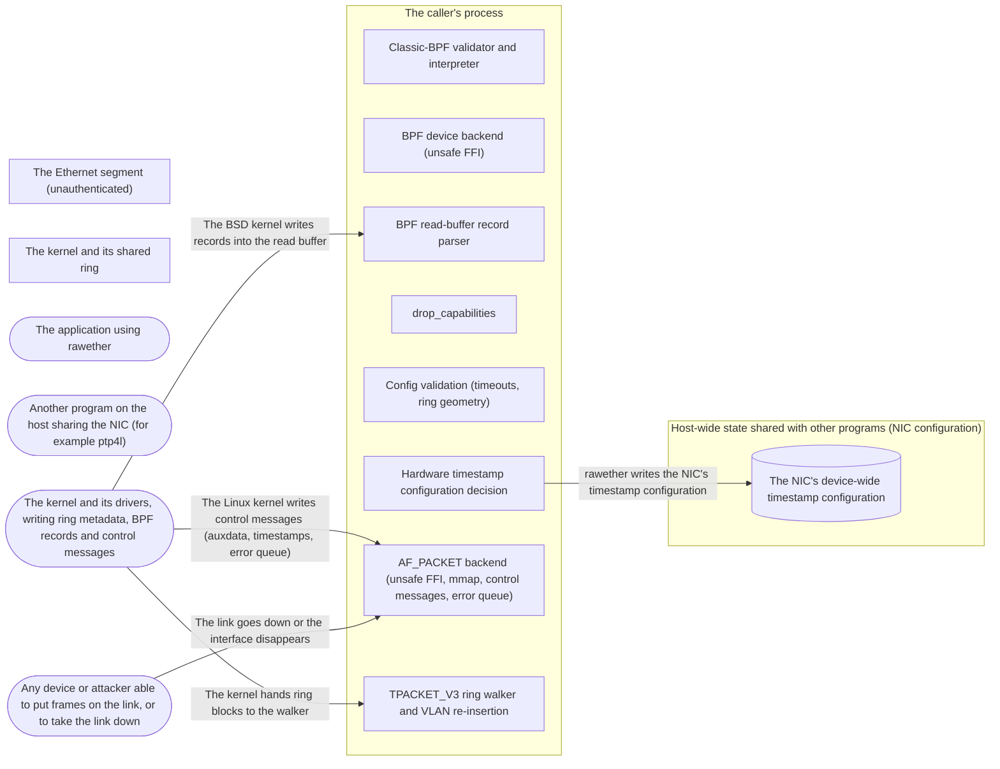

# Threat Model: Audit remediation — correct on every platform, harmless to the host

**Feature**: `003-audit-remediation` · **Generated**: 2026-11-09T11:48:24Z · **Profiles**: stride · **Canonical**: `threat-model.yaml`

> Rendered by ThreatSpec. Edit `threat-model.yaml`, not this file.

## Summary

| Threats | Critical | High | Medium | Low | Needs clarification | Not applicable | Mitigations | Requirements | Decisions |
|---|---|---|---|---|---|---|---|---|---|
| 12 | 2 | 2 | 6 | 2 | 0 | 5 | 12 | 12 | 0 |

## Actors

| ID | Name | Trust | Description |
|---|---|---|---|
| `actor.caller` | The application using rawether | trusted |  |
| `actor.host-program` | Another program on the host sharing the NIC (for example ptp4l) | trusted |  |
| `actor.kernel` | The kernel and its drivers, writing ring metadata, BPF records and control messages | privileged |  |
| `actor.segment-peer` | Any device or attacker able to put frames on the link, or to take the link down | untrusted |  |

## Trust Zones

| ID | Name | Trust rating | Description |
|---|---|---|---|
| `tz.host` | Host-wide state shared with other programs (NIC configuration) | 7 |  |
| `tz.kernel` | The kernel and its shared ring | 9 |  |
| `tz.link` | The Ethernet segment (unauthenticated) | 1 |  |
| `tz.process` | The caller's process | 8 |  |

## Assets

| ID | Name | Type | Classification | C / I / A | Source |
|---|---|---|---|---|---|
| `asset.accounting` | Counters and configuration the caller relies on: stats, tx_errors, the receive path and timestamping in effect | business-data | internal | 0 / 70 / 20 | spec.md#User-Story-5 |
| `asset.host-time-sync` | The NIC's hardware timestamping configuration that other programs (ptp4l) rely on for clock synchronisation | business-data | internal | 0 / 85 / 85 | spec.md#User-Story-3 |
| `asset.process-memory` | Memory safety of the caller's process | business-data | internal | 80 / 95 / 80 | THREAT_MODEL.md#Assets |
| `asset.raw-capability` | The raw-socket capability (CAP_NET_RAW, CAP_NET_ADMIN) held by any thread of the process | credential | restricted | 60 / 85 / 30 | spec.md#User-Story-2 |
| `asset.receive-availability` | The caller's receive loop: delivering frames without stalling, spinning or crashing | business-data | internal | 0 / 40 / 85 | spec.md#User-Story-4 |

## Components

| ID | Name | Type | Trust zone | Source |
|---|---|---|---|---|
| `component.bpf` | Classic-BPF validator and interpreter | library | `tz.process` | spec.md#FR-010 |
| `component.bsd-backend` | BPF device backend (unsafe FFI) | library | `tz.process` | spec.md#FR-002 |
| `component.bsd-parser` | BPF read-buffer record parser | library | `tz.process` | spec.md#FR-001 |
| `component.capability-drop` | drop_capabilities | library | `tz.process` | spec.md#FR-004 |
| `component.config` | Config validation (timeouts, ring geometry) | library | `tz.process` | spec.md#FR-009 |
| `component.hwtstamp-config` | Hardware timestamp configuration decision | library | `tz.process` | spec.md#FR-005 |
| `component.linux-backend` | AF_PACKET backend (unsafe FFI, mmap, control messages, error queue) | library | `tz.process` | spec.md#FR-011 |
| `component.nic` | The NIC's device-wide timestamp configuration | datastore | `tz.host` | spec.md#User-Story-3 |
| `component.ring-walker` | TPACKET_V3 ring walker and VLAN re-insertion | library | `tz.process` | spec.md#FR-012 |

## Data Flows

| ID | Name | From | To | Assets | Crosses |
|---|---|---|---|---|---|
| `flow.bpf-read-buffer` | The BSD kernel writes records into the read buffer | `actor.kernel` | `component.bsd-parser` | `asset.process-memory`, `asset.receive-availability` | `tz.kernel`, `tz.process` |
| `flow.control-messages` | The Linux kernel writes control messages (auxdata, timestamps, error queue) | `actor.kernel` | `component.linux-backend` | `asset.process-memory`, `asset.accounting` | `tz.kernel`, `tz.process` |
| `flow.hwtstamp-write` | rawether writes the NIC's timestamp configuration | `component.hwtstamp-config` | `component.nic` | `asset.host-time-sync` | `tz.process`, `tz.host` |
| `flow.link-state` | The link goes down or the interface disappears | `actor.segment-peer` | `component.linux-backend` | `asset.receive-availability` | `tz.link`, `tz.process` |
| `flow.ring-blocks` | The kernel hands ring blocks to the walker | `actor.kernel` | `component.ring-walker` | `asset.process-memory` | `tz.kernel`, `tz.process` |

## Threats

| ID | Threat | Category | Technique | Severity | Status | Mitigations | Mappings | Source |
|---|---|---|---|---|---|---|---|---|
| `threat.bpf-record-misparse` | The BSD record parser assumes one platform's header layout, so on FreeBSD it rejects every record the kernel writes and the caller's receive never returns a frame | Denial of Service | resource-exhaustion | **critical** | mitigated | `mitigation.layout-aware-record-parse` |  | spec.md#User-Story-1 |
| `threat.nic-timestamp-config-clobbered` | Opening a socket with hardware timestamps overwrites the NIC's device-wide configuration, turning off the transmit stamps ptp4l needs and degrading the host's time synchronisation | Tampering, Denial of Service | data-tampering-in-transit | **critical** | mitigated | `mitigation.read-first-never-lower` |  | spec.md#User-Story-3 |
| `threat.capability-kept-by-other-threads` | Threads that existed before drop_capabilities keep CAP_NET_RAW, so a parser defect exploited in any thread still reaches raw-network privilege through the shared address space | Elevation of Privilege | broken-access-control | **high** | mitigated | `mitigation.process-wide-capability-check` |  | spec.md#User-Story-2 |
| `threat.recv-spins-on-socket-error` | When the link goes down or the interface is removed, a ring receive sees the descriptor as ready forever and spins a CPU core instead of returning, until its deadline or never | Denial of Service | resource-exhaustion | **high** | mitigated | `mitigation.socket-error-surfaces` |  | spec.md#User-Story-4 |
| `threat.control-message-overread` | A control message shorter than the structure read from it, or a truncated control buffer, makes the backend read past the message into its own state | Tampering | injection | **medium** | mitigated | `mitigation.checked-control-messages` |  | spec.md#User-Story-6 |
| `threat.numeric-limits-panic` | A caller passes Duration::MAX as a timeout, a huge ring geometry or a far BPF jump, and rawether panics or wraps instead of refusing | Denial of Service | resource-exhaustion | **medium** | mitigated | `mitigation.checked-arithmetic` |  | spec.md#User-Story-4 |
| `threat.own-frames-on-freebsd` | On FreeBSD a socket configured not to see its own transmissions receives them anyway, so a responder can answer itself in a loop | Tampering, Denial of Service | data-tampering-in-transit | **medium** | mitigated | `mitigation.freebsd-direction` |  | spec.md#User-Story-1 |
| `threat.ring-mutable-alias` | A mutable slice over a whole ring block, descriptor included, asserts exclusive access to memory the kernel still reads, which the compiler may exploit | Tampering | injection | **medium** | mitigated | `mitigation.narrow-ring-borrows` |  | spec.md#User-Story-6 |
| `threat.silent-downgrade` | An explicitly requested ring that the kernel refuses becomes the plain path without an error, so the caller runs with a configuration it did not ask for | Tampering | data-tampering-in-transit | **medium** | mitigated | `mitigation.explicit-ring-errors` |  | spec.md#User-Story-4 |
| `threat.tx-errors-miscounted` | tx_errors counts every error-queue message, so the caller cannot tell launch-time drops from other reports, nor why a frame was dropped | Repudiation | injection | **medium** | open | `mitigation.parsed-error-queue` |  | spec.md#User-Story-5 |
| `threat.sockaddr-provenance` | The BSD hardware-address lookup reads past the reference it derived its pointer from, undefined behaviour under the language's aliasing model | Tampering | injection | **low** | mitigated | `mitigation.raw-pointer-provenance` |  | spec.md#User-Story-1 |
| `threat.stats-misreport` | On BSD stats().received counts frames before the filter, so a caller sizing buffers or detecting loss reads a number that means something else than on Linux | Tampering | data-tampering-in-transit | **low** | mitigated | `mitigation.counted-deliveries` |  | spec.md#User-Story-5 |

### Techniques evaluated without findings

| Technique | Disposition | Reason |
|---|---|---|
| credential-theft | not-applicable | no authentication surface: no credentials are handled; the raw-socket privilege is modelled under broken-access-control |
| identity-spoofing | no-threat-detected | checked the changed paths (BSD parser, capability drop, timestamp config, error queue): none relies on a sender's identity; frame authenticity stays out of scope (THREAT_MODEL.md) |
| data-tampering-at-rest | not-applicable | no persistent-store surface: nothing is written to disk |
| missing-audit-trail | not-applicable | no audit-relevant surface: a socket library keeps no audit log |
| cross-tenant-leak | not-applicable | no shared-tenant surface: one socket belongs to one process |
| privilege-escalation-via-config | not-applicable | no persistent-store surface: configuration is a value built in code |
| sensitive-data-exposure | no-threat-detected | checked the changed read paths: the BSD parser and control-message reads only shorten or skip data; they disclose nothing new; over-reads are modelled as tampering of process memory |

## Mitigations

| ID | Mitigation | Kind | Threats | Requirements | Touchpoints | Status |
|---|---|---|---|---|---|---|
| `mitigation.checked-arithmetic` | checked_add for deadlines (overflow = no deadline), checked_mul and limits for ring geometry, checked_add for BPF jumps | preventive | `threat.numeric-limits-panic` | SR-008 | `src/sys/mod.rs`, `src/config.rs`, `src/bpf.rs` | verified |
| `mitigation.checked-control-messages` | Skip control messages when MSG_CTRUNC is set or cmsg_len is shorter than the payload read | preventive | `threat.control-message-overread` | SR-005 | `src/sys/linux.rs` | verified |
| `mitigation.counted-deliveries` | On BSD count delivered records for stats().received; bs_drop for dropped | detective | `threat.stats-misreport` | SR-012 | `src/sys/bsd.rs` | verified |
| `mitigation.explicit-ring-errors` | An explicit RxMode::Ring that fails to set up fails the open; Auto falls back and reports it | preventive | `threat.silent-downgrade` | SR-009 | `src/sys/linux.rs` | verified |
| `mitigation.freebsd-direction` | Set BIOCSDIRECTION to BPF_D_IN on FreeBSD unless see_outgoing | preventive | `threat.own-frames-on-freebsd` | SR-010 | `src/sys/bsd.rs` | verified |
| `mitigation.layout-aware-record-parse` | Parse BPF records field by field with per-platform offsets from the libc struct and the kernel's SIZEOF_BPF_HDR minimum | preventive | `threat.bpf-record-misparse` | SR-001 | `src/bpf_record.rs`, `src/sys/bsd.rs`, `fuzz/fuzz_targets/bpf_record.rs` | verified |
| `mitigation.narrow-ring-borrows` | The walker reads a shared slice; only the frame range VLAN re-insertion writes is borrowed mutably | preventive | `threat.ring-mutable-alias` | SR-006 | `src/ring.rs`, `src/vlan.rs`, `src/sys/linux.rs` | verified |
| `mitigation.parsed-error-queue` | Parse sock_extended_err and count only SO_EE_ORIGIN_TXTIME, by code | detective | `threat.tx-errors-miscounted` | SR-011 | `src/sys/linux.rs`, `src/lib.rs` | required |
| `mitigation.process-wide-capability-check` | Clear all capability sets of the calling thread, drop the bounding set where allowed, require no_new_privs, then refuse when any other thread still holds a capability | preventive | `threat.capability-kept-by-other-threads` | SR-002 | `src/sys/linux.rs`, `tests/drop_capabilities.rs` | verified |
| `mitigation.raw-pointer-provenance` | Derive the link-layer address pointer from the raw ifa_addr pointer and offset_of! | preventive | `threat.sockaddr-provenance` | SR-007 | `src/sys/bsd.rs` | verified |
| `mitigation.read-first-never-lower` | Read the NIC's timestamp configuration first; never write one that could not be read; keep tx_type; widen the RX filter only from none | preventive | `threat.nic-timestamp-config-clobbered` | SR-003 | `src/hwtstamp.rs`, `src/sys/linux.rs` | verified |
| `mitigation.socket-error-surfaces` | On POLLERR/POLLHUP read SO_ERROR and return it from recv, on both receive paths | preventive | `threat.recv-spins-on-socket-error` | SR-004 | `src/sys/mod.rs`, `src/sys/linux.rs`, `tests/veth.rs` | verified |

## Security Requirements

### SR-001 (P1) — verified

The BSD record parser MUST accept both macOS (minimum header 18) and FreeBSD (minimum header 26) layouts, read header fields only inside the buffer, and stop without panicking at a malformed or truncated record.

- **Given** a FreeBSD-layout buffer with three records, **when** it is parsed, **then** three frames are returned with their lengths and timestamps
- **Given** a record with hdrlen below the minimum, or a header cut off at the buffer end, **when** it is parsed, **then** parsing stops and nothing panics or reads outside the buffer
- **Given** random buffers, **when** they are parsed with each layout, **then** no panic and every frame lies inside the buffer
- Mitigations: `mitigation.layout-aware-record-parse`
- Tasks: T004 ✓, T005 ✓, T006 ✓
- Verification `verification.sr-001.2026-11-09`: test → pass (verified) — `src/bpf_record.rs::tests::records_of_both_layouts_are_read; src/bpf_record.rs::tests::malformed_records_end_the_buffer; src/bpf_record.rs::tests::random_buffers_never_escape; fuzz target bpf_record`

### SR-002 (P1) — verified

drop_capabilities MUST leave no thread of the process with an effective, permitted, inheritable or ambient capability and MUST set no_new_privs, or return an error naming the threads that still hold capabilities.

- **Given** a single-threaded process with CAP_NET_RAW and an open socket, **when** drop_capabilities returns Ok, **then** every /proc/self/task/*/status shows zero CapEff, CapPrm, CapInh and CapAmb, NoNewPrivs is 1, and the socket still sends and receives
- **Given** a second thread holding capabilities, **when** drop_capabilities runs, **then** it returns an error naming one thread
- Mitigations: `mitigation.process-wide-capability-check`
- Tasks: T010 ✓, T011 ✓
- Verification `verification.sr-002.2026-11-09`: test → pass (verified) — `tests/drop_capabilities.rs (run by scripts/veth-test.sh, Docker, 2026-11-09); src/sys/linux.rs::tests::a_thread_status_shows_whether_it_holds_capabilities`

### SR-003 (P1) — verified

With hardware timestamps requested, rawether MUST NOT write a NIC timestamp configuration it could not read, MUST NOT lower tx_type or narrow the RX filter, and MUST widen the RX filter only from none.

- **Given** every combination of current tx_type and rx_filter, and whether configuring is allowed, **when** the decision runs, **then** the written configuration (if any) keeps tx_type and changes rx_filter only from NONE to ALL
- **Given** a NIC whose configuration cannot be read, **when** a hardware-timestamping socket opens, **then** no configuration is written and the socket reports software timestamps
- Mitigations: `mitigation.read-first-never-lower`
- Tasks: T014 ✓, T015 ✓
- Verification `verification.sr-003.2026-11-09`: test → pass (verified) — `src/hwtstamp.rs::tests::the_nic_configuration_is_never_lowered; tests/veth.rs::hardware_timestamps_on_a_nic_without_them_report_software`

### SR-004 (P1) — verified

A receive on either Linux path MUST return the socket's pending error instead of polling again when the descriptor reports an error or hang-up.

- **Given** a socket waiting in recv with a 2 s timeout on the ring and on the plain path, **when** the link goes down or the interface is deleted, **then** recv returns an error within 100 ms
- **Given** the link back up, **when** a frame is sent, **then** the socket receives it again
- Mitigations: `mitigation.socket-error-surfaces`
- Tasks: T021 ✓
- Verification `verification.sr-004.2026-11-09`: test → pass (verified) — `tests/veth.rs::a_link_going_down_ends_a_receive_and_frames_return_after_it_comes_up; tests/veth.rs::deleting_the_interface_ends_a_receive`

### SR-005 (P2) — verified

Control messages MUST be read only when MSG_CTRUNC is clear and cmsg_len covers the payload read.

- **Given** a control buffer with a message whose cmsg_len is shorter than the payload type, **when** it is parsed, **then** the message is skipped
- **Given** msg_flags with MSG_CTRUNC, **when** the messages are parsed, **then** none is read
- Mitigations: `mitigation.checked-control-messages`
- Tasks: T028 ✓
- Verification `verification.sr-005.2026-11-09`: test → pass (verified) — `src/sys/linux.rs::tests::a_short_control_message_is_skipped`

### SR-006 (P2) — verified

The ring walker MUST read blocks through a shared slice and borrow mutably only the octets VLAN re-insertion writes.

- **Given** the ring module, **when** its signatures are reviewed and its tests run under Miri, **then** the walker takes &[u8], re-insertion takes a &mut range of the frame only, and Miri reports nothing
- Mitigations: `mitigation.narrow-ring-borrows`
- Tasks: T027 ✓
- Verification `verification.sr-006.2026-11-09`: review → pass (verified) — `src/sys/linux.rs (Ring::block returns &[u8]; Ring::frame_mut borrows only start-4..start+len; ring_next); Miri on ring and vlan tests`

### SR-007 (P3) — verified

The BSD hardware-address lookup MUST derive its read pointer from the raw ifa_addr pointer, never from a reference to sockaddr_dl.

- **Given** the lookup code, **when** it is reviewed, **then** no &sockaddr_dl is formed and the offset comes from offset_of!; the macOS test still opens lo0
- Mitigations: `mitigation.raw-pointer-provenance`
- Tasks: T008 ✓
- Verification `verification.sr-007.2026-11-09`: review → pass (verified) — `src/sys/bsd.rs hardware_address`

### SR-008 (P2) — verified

No timeout, ring geometry or BPF program MUST cause a panic or a wrapped value, on 64-bit and 32-bit targets.

- **Given** recv with Duration::MAX, **when** it runs on a non-blocking socket, **then** it returns without panicking
- **Given** a ring geometry whose total size overflows u32 or usize, or a block count above the limit, **when** it is validated, **then** InvalidInput
- **Given** a BPF ja with k = u32::MAX, **when** Program::new and Program::run run, **then** it is refused, and run returns 0
- Mitigations: `mitigation.checked-arithmetic`
- Tasks: T003 ✓, T017 ✓, T018 ✓, T020 ✓
- Verification `verification.sr-008.2026-11-09`: test → pass (verified) — `src/sys/mod.rs::tests::waits_never_overflow_and_round_up; src/config.rs::tests::a_configuration_is_checked_before_any_system_call; src/bpf.rs::tests::a_far_jump_is_refused_on_every_pointer_width; tests/veth.rs::a_huge_timeout_waits_and_an_impossible_ring_is_refused`

### SR-009 (P2) — verified

An explicit RxMode::Ring that cannot be set up MUST fail the open with the kernel's reason; RxMode::Auto MUST fall back and report RxPath::Plain.

- **Given** RxMode::Ring with a block size that is not a page multiple, **when** the socket opens, **then** it fails with InvalidInput
- Mitigations: `mitigation.explicit-ring-errors`
- Tasks: T018 ✓, T019 ✓
- Verification `verification.sr-009.2026-11-09`: test → pass (verified) — `tests/veth.rs::a_huge_timeout_waits_and_an_impossible_ring_is_refused`

### SR-010 (P2) — verified

On FreeBSD a socket without see_outgoing MUST set BIOCSDIRECTION to BPF_D_IN.

- **Given** the FreeBSD backend, **when** a socket opens without see_outgoing, **then** BIOCSDIRECTION(BPF_D_IN) is issued and checked (FreeBSD CI build; review)
- Mitigations: `mitigation.freebsd-direction`
- Tasks: T007 ✓
- Verification `verification.sr-010.2026-11-09`: review → pass (verified) — `src/sys/bsd.rs open (BIOCSDIRECTION, BPF_D_IN); src/sys/bsd.rs::tests::locally_defined_ioctls_match_the_headers`

### SR-011 (P2) — has-evidence

tx_errors MUST count only SO_EE_ORIGIN_TXTIME messages and report missed deadlines and invalid parameters separately.

- **Given** sock_extended_err records of origin TXTIME code MISSED, code INVALID_PARAM, and origin LOCAL, **when** they are classified, **then** one missed, one invalid, the LOCAL one ignored
- **Given** a frame with a past launch time through etf on veth, **when** tx_errors is read, **then** missed >= 1
- Mitigations: `mitigation.parsed-error-queue`
- Tasks: T023 ✓, T024 ✓, T039
- Verification `verification.sr-011.2026-11-09`: test → inconclusive (implemented-unverified) — `src/sys/linux.rs::tests::only_launch_time_reports_are_counted`

### SR-012 (P3) — verified

stats().received MUST count only frames that passed the filter, on every backend.

- **Given** a BSD socket with a filter, **when** frames are read and stats() is read, **then** received equals the frames delivered (review of the counter; macOS loopback test where privileged)
- Mitigations: `mitigation.counted-deliveries`
- Tasks: T006 ✓, T026 ✓
- Verification `verification.sr-012.2026-11-09`: review → pass (verified) — `src/sys/bsd.rs (recv increments delivered; stats returns delivered and bs_drop); src/packet.rs Stats rustdoc`
