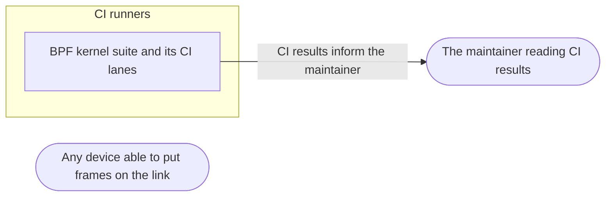

# Threat Model: BSD receive proven

**Feature**: `004-macos-receive` · **Generated**: 2026-11-09T14:09:00Z · **Profiles**: stride · **Canonical**: `threat-model.yaml`

> Rendered by ThreatSpec. Edit `threat-model.yaml`, not this file.

## Summary

| Threats | Critical | High | Medium | Low | Needs clarification | Not applicable | Mitigations | Requirements | Decisions |
|---|---|---|---|---|---|---|---|---|---|
| 1 | 0 | 0 | 1 | 0 | 0 | 6 | 1 | 1 | 0 |

## Actors

| ID | Name | Trust | Description |
|---|---|---|---|
| `actor.maintainer` | The maintainer reading CI results | trusted |  |
| `actor.segment-peer` | Any device able to put frames on the link | untrusted |  |

## Trust Zones

| ID | Name | Trust rating | Description |
|---|---|---|---|
| `tz.ci` | CI runners | 6 |  |

## Assets

| ID | Name | Type | Classification | C / I / A | Source |
|---|---|---|---|---|---|
| `asset.platform-claims` | The truth of the README's macOS and FreeBSD claims | business-data | public | 0 / 80 / 30 | spec.md#User-Story-1 |

## Components

| ID | Name | Type | Trust zone | Source |
|---|---|---|---|---|
| `component.bsd-suite` | BPF kernel suite and its CI lanes | library | `tz.ci` | spec.md#FR-001 |

## Data Flows

| ID | Name | From | To | Assets | Crosses |
|---|---|---|---|---|---|
| `flow.ci-results` | CI results inform the maintainer | `component.bsd-suite` | `actor.maintainer` | `asset.platform-claims` | `tz.ci` |

## Threats

| ID | Threat | Category | Technique | Severity | Status | Mitigations | Mappings | Source |
|---|---|---|---|---|---|---|---|---|
| `threat.silent-skip` | The BSD suite skips silently in CI when the pair cannot be created, so a green lane claims receive works when nothing ran | Repudiation | missing-audit-trail | **medium** | open | `mitigation.require-pair` |  | spec.md#Edge-Cases |

### Techniques evaluated without findings

| Technique | Disposition | Reason |
|---|---|---|
| credential-theft | not-applicable | no authentication surface |
| identity-spoofing | not-applicable | no authentication surface |
| data-tampering-in-transit | no-threat-detected | checked: the suite only observes the existing BPF backend; no new data path |
| data-tampering-at-rest | not-applicable | no persistent-store surface |
| missing-audit-trail | not-applicable | no audit-relevant surface |
| sensitive-data-exposure | no-threat-detected | checked: the CI step widens /dev/bpf* access only inside a throwaway runner |
| cross-tenant-leak | not-applicable | no shared-tenant surface |
| resource-exhaustion | no-threat-detected | checked: fixed frame counts and timeouts |
| broken-access-control | no-threat-detected | checked: the suite exercises the existing /dev/bpf permission check, it adds none |
| privilege-escalation-via-config | not-applicable | no persistent-store surface |

## Mitigations

| ID | Mitigation | Kind | Threats | Requirements | Touchpoints | Status |
|---|---|---|---|---|---|---|
| `mitigation.require-pair` | RAWETHER_REQUIRE_PAIR in CI makes a missing pair a failure | detective | `threat.silent-skip` | SR-001 | `tests/bpf.rs`, `.github/workflows/ci.yml` | required |

## Security Requirements

### SR-001 (P2) — unverified

In CI the BSD suite MUST fail, not skip, when its interface pair is missing.

- **Given** RAWETHER_REQUIRE_PAIR set and no pair, **when** the suite starts, **then** it fails naming the missing pair
- Mitigations: `mitigation.require-pair`
- Tasks: — none —
