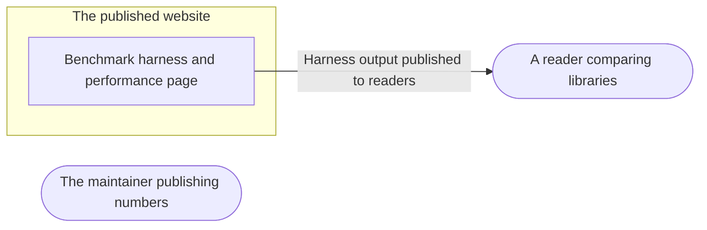

# Threat Model: Published benchmarks

**Feature**: `006-bench` · **Generated**: 2026-11-09T14:11:04Z · **Profiles**: stride · **Canonical**: `threat-model.yaml`

> Rendered by ThreatSpec. Edit `threat-model.yaml`, not this file.

## Summary

| Threats | Critical | High | Medium | Low | Needs clarification | Not applicable | Mitigations | Requirements | Decisions |
|---|---|---|---|---|---|---|---|---|---|
| 1 | 0 | 0 | 1 | 0 | 0 | 7 | 1 | 1 | 0 |

## Actors

| ID | Name | Trust | Description |
|---|---|---|---|
| `actor.maintainer` | The maintainer publishing numbers | trusted |  |
| `actor.reader` | A reader comparing libraries | untrusted |  |

## Trust Zones

| ID | Name | Trust rating | Description |
|---|---|---|---|
| `tz.site` | The published website | 5 |  |

## Assets

| ID | Name | Type | Classification | C / I / A | Source |
|---|---|---|---|---|---|
| `asset.published-claims` | The truth of published performance numbers | business-data | public | 0 / 80 / 10 | spec.md#User-Story-1 |

## Components

| ID | Name | Type | Trust zone | Source |
|---|---|---|---|---|
| `component.bench` | Benchmark harness and performance page | library | `tz.site` | spec.md#FR-001 |

## Data Flows

| ID | Name | From | To | Assets | Crosses |
|---|---|---|---|---|---|
| `flow.numbers` | Harness output published to readers | `component.bench` | `actor.reader` | `asset.published-claims` | `tz.site` |

## Threats

| ID | Threat | Category | Technique | Severity | Status | Mitigations | Mappings | Source |
|---|---|---|---|---|---|---|---|---|
| `threat.misleading-numbers` | Published numbers cannot be traced to a run or a method, or compare libraries unfairly, misleading readers | Repudiation | missing-audit-trail | **medium** | open | `mitigation.recorded-runs` |  | spec.md#SC-002 |

### Techniques evaluated without findings

| Technique | Disposition | Reason |
|---|---|---|
| credential-theft | not-applicable | no authentication surface |
| identity-spoofing | not-applicable | no authentication surface |
| data-tampering-in-transit | not-applicable | no network-boundary surface: the harness runs locally |
| data-tampering-at-rest | not-applicable | no persistent-store surface |
| sensitive-data-exposure | no-threat-detected | checked: the page publishes CPU, kernel and date only |
| cross-tenant-leak | not-applicable | no shared-tenant surface |
| resource-exhaustion | no-threat-detected | checked: bounded frame counts, run on demand only |
| broken-access-control | not-applicable | no authorization surface |
| privilege-escalation-via-config | not-applicable | no persistent-store surface |
| injection | no-threat-detected | checked: the harness parses only its own frames' payloads |

## Mitigations

| ID | Mitigation | Kind | Threats | Requirements | Touchpoints | Status |
|---|---|---|---|---|---|---|
| `mitigation.recorded-runs` | The page states the date, kernel, CPU, command and method; the same sender and traffic for every receiver; loss reported | detective | `threat.misleading-numbers` | SR-001 | `bench/src/main.rs`, `site/content/docs/performance.md` | required |

## Security Requirements

### SR-001 (P2) — unverified

Every published number MUST come from a recorded harness run whose date, environment, command and method are on the page, with the same sender and traffic for every receiver.

- **Given** the performance page, **when** it is reviewed against the harness output, **then** every number matches the recorded run, and the method lists sender, traffic and filters per receiver
- Mitigations: `mitigation.recorded-runs`
- Tasks: — none —
