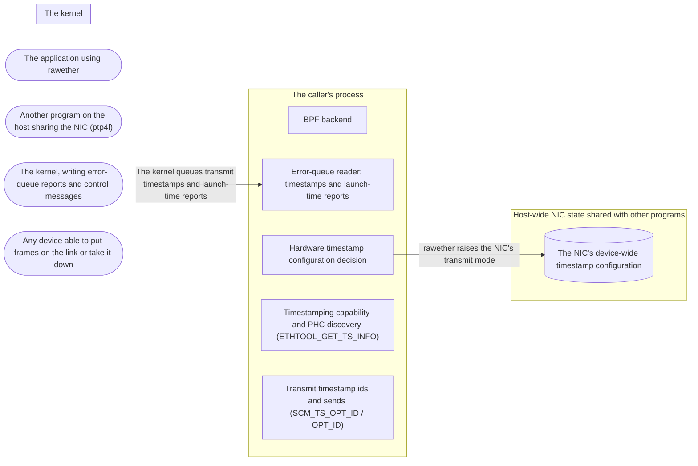

# Threat Model: PTP precision — transmit timestamps and clock discovery

**Feature**: `007-ptp-precision` · **Generated**: 2026-11-09T13:55:18Z · **Profiles**: stride · **Canonical**: `threat-model.yaml`

> Rendered by ThreatSpec. Edit `threat-model.yaml`, not this file.

## Summary

| Threats | Critical | High | Medium | Low | Needs clarification | Not applicable | Mitigations | Requirements | Decisions |
|---|---|---|---|---|---|---|---|---|---|
| 6 | 0 | 3 | 3 | 0 | 0 | 5 | 6 | 6 | 0 |

## Actors

| ID | Name | Trust | Description |
|---|---|---|---|
| `actor.caller` | The application using rawether | trusted |  |
| `actor.host-program` | Another program on the host sharing the NIC (ptp4l) | trusted |  |
| `actor.kernel` | The kernel, writing error-queue reports and control messages | privileged |  |
| `actor.segment-peer` | Any device able to put frames on the link or take it down | untrusted |  |

## Trust Zones

| ID | Name | Trust rating | Description |
|---|---|---|---|
| `tz.host` | Host-wide NIC state shared with other programs | 7 |  |
| `tz.kernel` | The kernel | 9 |  |
| `tz.process` | The caller's process | 8 |  |

## Assets

| ID | Name | Type | Classification | C / I / A | Source |
|---|---|---|---|---|---|
| `asset.host-time-sync` | The NIC's timestamping configuration other programs (ptp4l) rely on | business-data | internal | 0 / 85 / 85 | spec.md#User-Story-3 |
| `asset.process-memory` | Memory safety of the caller's process | business-data | internal | 80 / 95 / 80 | THREAT_MODEL.md#Assets |
| `asset.receive-availability` | The caller's receive loop and memory | business-data | internal | 0 / 30 / 85 | spec.md#User-Story-4 |
| `asset.tx-accounting` | Launch-time drop counts and lost-timestamp counts | business-data | internal | 0 / 70 / 20 | spec.md#User-Story-4 |
| `asset.tx-time-integrity` | The pairing of each transmit timestamp with the frame it belongs to | business-data | internal | 0 / 95 / 40 | spec.md#User-Story-1 |

## Components

| ID | Name | Type | Trust zone | Source |
|---|---|---|---|---|
| `component.bsd-backend` | BPF backend | library | `tz.process` | spec.md#FR-010 |
| `component.error-queue` | Error-queue reader: timestamps and launch-time reports | library | `tz.process` | spec.md#FR-008 |
| `component.hwtstamp-config` | Hardware timestamp configuration decision | library | `tz.process` | spec.md#FR-005 |
| `component.nic` | The NIC's device-wide timestamp configuration | datastore | `tz.host` | spec.md#User-Story-3 |
| `component.ts-info` | Timestamping capability and PHC discovery (ETHTOOL_GET_TS_INFO) | library | `tz.process` | spec.md#FR-007 |
| `component.tx-stamping` | Transmit timestamp ids and sends (SCM_TS_OPT_ID / OPT_ID) | library | `tz.process` | spec.md#FR-002 |

## Data Flows

| ID | Name | From | To | Assets | Crosses |
|---|---|---|---|---|---|
| `flow.error-queue` | The kernel queues transmit timestamps and launch-time reports | `actor.kernel` | `component.error-queue` | `asset.tx-time-integrity`, `asset.tx-accounting`, `asset.process-memory` | `tz.kernel`, `tz.process` |
| `flow.hwtstamp-write` | rawether raises the NIC's transmit mode | `component.hwtstamp-config` | `component.nic` | `asset.host-time-sync` | `tz.process`, `tz.host` |

## Threats

| ID | Threat | Category | Technique | Severity | Status | Mitigations | Mappings | Source |
|---|---|---|---|---|---|---|---|---|
| `threat.error-queue-starves-receive` | Unread transmit timestamps keep the socket's error flag raised, so a receive spins a core, or an unbounded buffer of them grows without limit | Denial of Service | resource-exhaustion | **high** | open | `mitigation.bounded-report-queue` |  | spec.md#User-Story-4 |
| `threat.nic-tx-config-lowered` | Requesting hardware transmit stamps changes the NIC's transmit mode under ptp4l (turning it off or out of a one-step mode), breaking the host's time synchronisation | Tampering, Denial of Service | data-tampering-in-transit | **high** | open | `mitigation.tx-read-first-never-lower` |  | spec.md#User-Story-3 |
| `threat.tx-timestamp-misattributed` | A send the kernel refuses after numbering it shifts the kernel's counter, so rawether hands the caller a transmit time belonging to a different frame and a PTP clock computes a wrong offset | Tampering | data-tampering-in-transit | **high** | open | `mitigation.explicit-ids` |  | spec.md#User-Story-1 |
| `threat.timestamp-cmsg-overread` | An error-queue report whose control messages are shorter than the timestamp or error structure read from them makes rawether read past the message | Tampering | injection | **medium** | open | `mitigation.checked-report-cmsgs` |  | spec.md#FR-008 |
| `threat.tx-reports-lost` | Reading transmit timestamps discards launch-time drop reports, or counting drops discards timestamps, so the caller loses one of them silently | Repudiation | injection | **medium** | open | `mitigation.one-dispatcher` |  | spec.md#User-Story-4 |
| `threat.unsupported-silently-ignored` | On macOS or FreeBSD a request for transmit timestamps is ignored, and a caller waiting for them blocks or gets none without knowing why | Denial of Service | resource-exhaustion | **medium** | open | `mitigation.unsupported-is-an-error` |  | spec.md#FR-010 |

### Techniques evaluated without findings

| Technique | Disposition | Reason |
|---|---|---|
| credential-theft | not-applicable | no authentication surface |
| identity-spoofing | no-threat-detected | checked the timestamp path: identifiers come from rawether's own counter or the kernel, never from the network |
| data-tampering-at-rest | not-applicable | no persistent-store surface |
| missing-audit-trail | not-applicable | no audit-relevant surface |
| cross-tenant-leak | not-applicable | no shared-tenant surface: one socket, one process |
| privilege-escalation-via-config | not-applicable | no persistent-store surface |
| broken-access-control | no-threat-detected | checked capability discovery: ETHTOOL_GET_TS_INFO is unprivileged by design and returns public metadata; NIC writes keep needing CAP_NET_ADMIN |
| sensitive-data-exposure | no-threat-detected | checked the error queue: OPT_TSONLY returns no frame payload, so no frame data is looped back into the process |

## Mitigations

| ID | Mitigation | Kind | Threats | Requirements | Touchpoints | Status |
|---|---|---|---|---|---|---|
| `mitigation.bounded-report-queue` | Drain the error queue into a preallocated, bounded queue on every POLLERR; drop the oldest and count | preventive | `threat.error-queue-starves-receive` | SR-003 | `src/sys/linux.rs` | required |
| `mitigation.checked-report-cmsgs` | Read scm_timestamping and sock_extended_err only through the length-checked cmsg reader; ignore truncated buffers | preventive | `threat.timestamp-cmsg-overread` | SR-005 | `src/sys/linux.rs` | required |
| `mitigation.explicit-ids` | Assign each frame's id in user space and pass it with SCM_TS_OPT_ID (Linux 6.13+), detected by the kernel accepting it; announce ids before the send | preventive | `threat.tx-timestamp-misattributed` | SR-001 | `src/sys/linux.rs`, `tests/veth.rs` | required |
| `mitigation.one-dispatcher` | One error-queue reader classifies every report: timestamps to the queue, launch-time reports to the counts | preventive | `threat.tx-reports-lost` | SR-004 | `src/sys/linux.rs` | required |
| `mitigation.tx-read-first-never-lower` | Raise tx_type only from OFF to ON, after a successful read; never touch one-step modes | preventive | `threat.nic-tx-config-lowered` | SR-002 | `src/hwtstamp.rs`, `src/sys/linux.rs` | required |
| `mitigation.unsupported-is-an-error` | open fails with Unsupported when transmit timestamps are requested on BPF | preventive | `threat.unsupported-silently-ignored` | SR-006 | `src/sys/bsd.rs` | required |

## Security Requirements

### SR-001 (P1) — unverified

Every transmit timestamp MUST carry the identifier the socket announced for its frame, also after a send the kernel refused (Linux 6.13 and later).

- **Given** 1 000 frames sent in single and batched sends with software transmit timestamps on veth, **when** the timestamps are read, **then** their identifiers are exactly the announced ones
- **Given** a send refused by an etf qdisc (past launch time), **when** 10 more frames are sent, **then** their timestamps carry the identifiers announced for them
- Mitigations: `mitigation.explicit-ids`
- Tasks: T004, T008

### SR-002 (P1) — unverified

Requesting hardware transmit timestamps MUST NOT change a NIC whose configuration could not be read, MUST raise tx_type only from OFF to ON, and MUST leave every other tx_type and the receive filter rule of 0.1.0 unchanged.

- **Given** every tx_type 0..=3, rx_filter 0..=15, and receive/transmit requests, **when** the decision runs, **then** a write raises tx_type only from OFF to ON, rx_filter only from NONE to ALL, and changes nothing else
- Mitigations: `mitigation.tx-read-first-never-lower`
- Tasks: T001, T011

### SR-003 (P1) — unverified

Unread transmit timestamps MUST NOT make a receive spin, and rawether MUST keep at most a fixed number of them, counting the ones it drops.

- **Given** a socket with transmit timestamps and 2 000 frames sent without reading their timestamps, **when** recv waits 200 ms with nothing to receive, **then** it returns after about 200 ms using little CPU, 1 024 timestamps can be read, and the lost count is the rest
- Mitigations: `mitigation.bounded-report-queue`
- Tasks: T006, T012

### SR-004 (P2) — unverified

Reading transmit timestamps MUST NOT discard launch-time reports, and reading launch-time reports MUST NOT discard timestamps.

- **Given** a socket with launch times and transmit timestamps through etf, one refused launch time and frames that left, **when** tx_errors and the timestamps are read in either order, **then** invalid = 1 and every sent frame's timestamp is there
- Mitigations: `mitigation.one-dispatcher`
- Tasks: T005, T012

### SR-005 (P2) — unverified

Error-queue control messages MUST be read only through the length-checked reader and ignored when the control buffer was truncated.

- **Given** the error-queue reader, **when** it is reviewed, **then** every payload is read with cmsg_payload and MSG_CTRUNC skips the message (unit test of the classifier over hand-built reports)
- Mitigations: `mitigation.checked-report-cmsgs`
- Tasks: T005

### SR-006 (P2) — unverified

Requesting transmit timestamps on a platform without them MUST make open fail with Unsupported.

- **Given** macOS or FreeBSD, **when** a socket with transmit timestamps opens, **then** Unsupported, naming transmit timestamps
- Mitigations: `mitigation.unsupported-is-an-error`
- Tasks: T013
