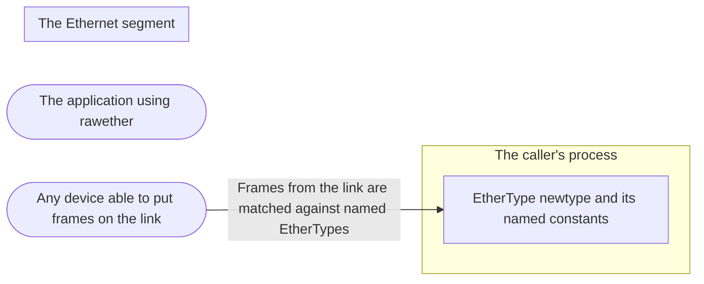

# Threat Model: Typed EtherType names

**Feature**: `015-ethertype` · **Generated**: 2026-11-09T14:05:52Z · **Profiles**: stride · **Canonical**: `threat-model.yaml`

> Rendered by ThreatSpec. Edit `threat-model.yaml`, not this file.

## Summary

| Threats | Critical | High | Medium | Low | Needs clarification | Not applicable | Mitigations | Requirements | Decisions |
|---|---|---|---|---|---|---|---|---|---|
| 2 | 0 | 0 | 1 | 1 | 0 | 7 | 2 | 2 | 0 |

## Actors

| ID | Name | Trust | Description |
|---|---|---|---|
| `actor.caller` | The application using rawether | trusted |  |
| `actor.segment-peer` | Any device able to put frames on the link | untrusted |  |

## Trust Zones

| ID | Name | Trust rating | Description |
|---|---|---|---|
| `tz.link` | The Ethernet segment | 1 |  |
| `tz.process` | The caller's process | 8 |  |

## Assets

| ID | Name | Type | Classification | C / I / A | Source |
|---|---|---|---|---|---|
| `asset.filter-intent` | The set of frames a caller means to receive, expressed through named EtherTypes | business-data | internal | 40 / 85 / 30 | spec.md#User-Story-3 |

## Components

| ID | Name | Type | Trust zone | Source |
|---|---|---|---|---|
| `component.ethertype` | EtherType newtype and its named constants | library | `tz.process` | spec.md#FR-001 |

## Data Flows

| ID | Name | From | To | Assets | Crosses |
|---|---|---|---|---|---|
| `flow.frames-to-filter` | Frames from the link are matched against named EtherTypes | `actor.segment-peer` | `component.ethertype` | `asset.filter-intent` | `tz.link`, `tz.process` |

## Threats

| ID | Threat | Category | Technique | Severity | Status | Mitigations | Mappings | Source |
|---|---|---|---|---|---|---|---|---|
| `threat.wrong-constant-value` | A named constant carries a wrong value, so a caller filtering for that protocol admits other traffic (or none) from the link without noticing | Tampering | injection | **medium** | mitigated | `mitigation.registry-table-test` |  | spec.md#User-Story-3 |
| `threat.length-read-as-type` | An 802.3 length in the EtherType field is treated as a protocol type by a caller, misrouting LLC frames | Tampering | injection | **low** | mitigated | `mitigation.is-length` |  | spec.md#Edge-Cases |

### Techniques evaluated without findings

| Technique | Disposition | Reason |
|---|---|---|
| credential-theft | not-applicable | no authentication surface |
| identity-spoofing | not-applicable | no authentication surface: names are compile-time constants |
| data-tampering-in-transit | no-threat-detected | checked the filter path: names convert to the same u16 the filter compiled before; covered by threat.wrong-constant-value |
| data-tampering-at-rest | not-applicable | no persistent-store surface |
| missing-audit-trail | not-applicable | no audit-relevant surface |
| sensitive-data-exposure | no-threat-detected | checked Display/Debug: they print a name and a number, nothing from frames |
| cross-tenant-leak | not-applicable | no shared-tenant surface |
| resource-exhaustion | no-threat-detected | checked: constants and a lookup over a fixed table, no allocation from input |
| broken-access-control | not-applicable | no authorization surface |
| privilege-escalation-via-config | not-applicable | no persistent-store surface |

## Mitigations

| ID | Mitigation | Kind | Threats | Requirements | Touchpoints | Status |
|---|---|---|---|---|---|---|
| `mitigation.is-length` | EtherType::is_length and Display of lengths as numbers only | preventive | `threat.length-read-as-type` | SR-002 | `src/ethertype.rs` | verified |
| `mitigation.registry-table-test` | A table test pins every constant to its registry value and source, and checks uniqueness and agreement with TagKind | detective | `threat.wrong-constant-value` | SR-001 | `src/ethertype.rs` | verified |

## Security Requirements

### SR-001 (P2) — verified

Every named EtherType MUST equal its registry value, no two names MAY share a value, and VLAN/QINQ MUST equal TagKind's TPIDs.

- **Given** the table of names, values and sources, **when** the test runs, **then** every constant matches, values are unique, VLAN = TagKind::Customer.tpid(), QINQ = TagKind::Service.tpid()
- Mitigations: `mitigation.registry-table-test`
- Tasks: T001 ✓
- Verification `verification.sr-001.2026-11-09`: test → pass (verified) — `src/ethertype.rs::tests::every_name_has_its_registry_value`

### SR-002 (P2) — verified

A value below 0x0600 MUST report is_length() and MUST NOT print a protocol name.

- **Given** 0x0050 and 0x05ff, **when** is_length and Display run, **then** true, and printed as numbers only
- Mitigations: `mitigation.is-length`
- Tasks: T001 ✓
- Verification `verification.sr-002.2026-11-09`: test → pass (verified) — `src/ethertype.rs::tests::lengths_and_unnamed_values_print_as_numbers`
