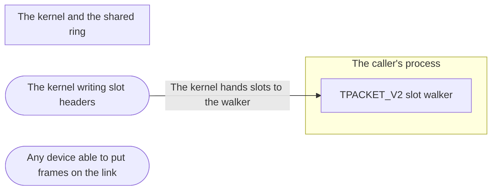

# Threat Model: Low-latency frame ring

**Feature**: `016-low-latency-ring` · **Generated**: 2026-11-09T15:22:33Z · **Profiles**: stride · **Canonical**: `threat-model.yaml`

> Rendered by ThreatSpec. Edit `threat-model.yaml`, not this file.

## Summary

| Threats | Critical | High | Medium | Low | Needs clarification | Not applicable | Mitigations | Requirements | Decisions |
|---|---|---|---|---|---|---|---|---|---|
| 2 | 0 | 0 | 2 | 0 | 0 | 7 | 2 | 2 | 0 |

## Actors

| ID | Name | Trust | Description |
|---|---|---|---|
| `actor.kernel` | The kernel writing slot headers | privileged |  |
| `actor.segment-peer` | Any device able to put frames on the link | untrusted |  |

## Trust Zones

| ID | Name | Trust rating | Description |
|---|---|---|---|
| `tz.kernel` | The kernel and the shared ring | 9 |  |
| `tz.process` | The caller's process | 8 |  |

## Assets

| ID | Name | Type | Classification | C / I / A | Source |
|---|---|---|---|---|---|
| `asset.process-memory` | Memory safety of the caller's process | business-data | internal | 80 / 95 / 80 | THREAT_MODEL.md#Assets |
| `asset.receive-availability` | Frames delivered without loss or stalls | business-data | internal | 0 / 30 / 80 | spec.md#User-Story-1 |

## Components

| ID | Name | Type | Trust zone | Source |
|---|---|---|---|---|
| `component.frame-ring` | TPACKET_V2 slot walker | library | `tz.process` | spec.md#FR-003 |

## Data Flows

| ID | Name | From | To | Assets | Crosses |
|---|---|---|---|---|---|
| `flow.slots` | The kernel hands slots to the walker | `actor.kernel` | `component.frame-ring` | `asset.process-memory`, `asset.receive-availability` | `tz.kernel`, `tz.process` |

## Threats

| ID | Threat | Category | Technique | Severity | Status | Mitigations | Mappings | Source |
|---|---|---|---|---|---|---|---|---|
| `threat.slot-never-released` | A skipped or malformed slot is never handed back, so the ring fills and every later frame is dropped | Denial of Service | resource-exhaustion | **medium** | mitigated | `mitigation.release-every-slot` |  | spec.md#FR-003 |
| `threat.slot-offsets-out-of-bounds` | A slot header whose tp_mac or tp_snaplen points outside the slot makes the walker form a slice outside the mapping | Tampering | injection | **medium** | mitigated | `mitigation.checked-slot-walk` |  | spec.md#User-Story-3 |

### Techniques evaluated without findings

| Technique | Disposition | Reason |
|---|---|---|
| credential-theft | not-applicable | no authentication surface |
| identity-spoofing | not-applicable | no authentication surface |
| data-tampering-at-rest | not-applicable | no persistent-store surface |
| missing-audit-trail | not-applicable | no audit-relevant surface |
| sensitive-data-exposure | no-threat-detected | checked: the ring maps only this socket's frames, as the block ring does |
| cross-tenant-leak | not-applicable | no shared-tenant surface |
| broken-access-control | not-applicable | no authorization surface |
| privilege-escalation-via-config | not-applicable | no persistent-store surface |
| data-tampering-in-transit | no-threat-detected | checked: frames are delivered as the kernel wrote them; integrity is the protocol's (THREAT_MODEL out of scope) |

## Mitigations

| ID | Mitigation | Kind | Threats | Requirements | Touchpoints | Status |
|---|---|---|---|---|---|---|
| `mitigation.checked-slot-walk` | Read a slot only after TP_STATUS_USER with acquire ordering; check mac >= header and mac + snaplen <= slot before slicing | preventive | `threat.slot-offsets-out-of-bounds` | SR-001 | `src/ring.rs`, `src/sys/linux.rs` | verified |
| `mitigation.release-every-slot` | Every slot taken is released on the next receive, whether delivered or skipped | preventive | `threat.slot-never-released` | SR-002 | `src/sys/linux.rs` | verified |

## Security Requirements

### SR-001 (P2) — verified

The frame-ring walker MUST NOT form a slice outside the slot, and MUST NOT read a slot whose status lacks TP_STATUS_USER.

- **Given** synthetic slots with tp_mac below the header, tp_mac or tp_snaplen past the slot, and a kernel-owned status, **when** they are read, **then** no frame is formed
- **Given** random slots, **when** fuzzed and run under Miri, **then** no panic, no out-of-bounds access
- Mitigations: `mitigation.checked-slot-walk`
- Tasks: T002 ✓, T003 ✓, T005 ✓
- Verification `verification.sr-001.2026-11-09`: test → pass (verified) — `src/ring.rs::tests::a_frame_ring_slot_is_read_only_when_it_holds_together; fuzz/fuzz_targets/ring_walk.rs (V2 slots, CI fuzz lane)`

### SR-002 (P2) — verified

Every frame-ring slot the reader takes MUST be returned to the kernel by the next receive, whether it was delivered or skipped.

- **Given** the veth suite on the frame ring (100 000-frame flood, sparse frames, malformed-free traffic), **when** it runs, **then** received plus dropped equals sent and later frames keep arriving
- Mitigations: `mitigation.release-every-slot`
- Tasks: T003 ✓, T006 ✓
- Verification `verification.sr-002.2026-11-09`: test → pass (verified) — `tests/veth.rs with RAWETHER_RX=frame (scripts/veth-test.sh): a_hundred_thousand_frames_are_received_or_counted_as_dropped, sparse_frames_wait_in_the_ring_while_the_reader_is_busy`
